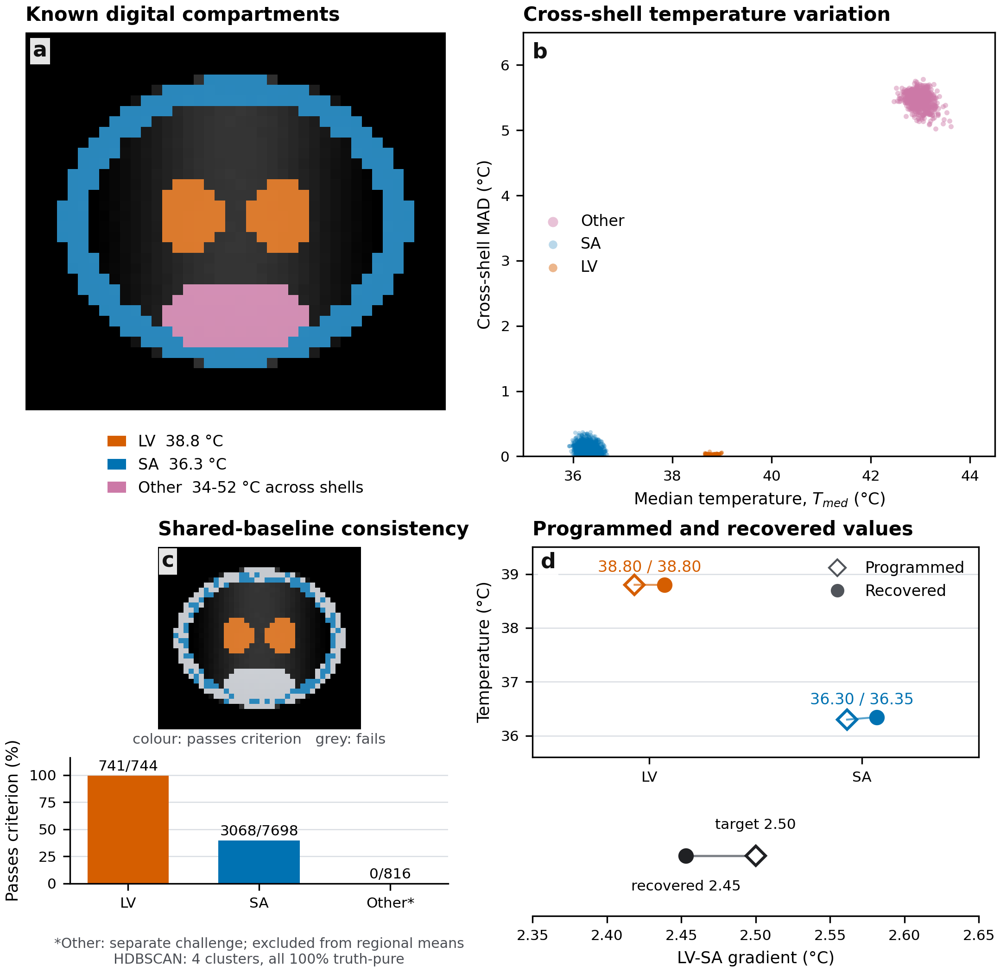

# Noise-referenced multi-shell DWI CSF thermometry

Version 1.1.1. Code and an analytic synthetic reference accompanying
*Noise-referenced multi-shell diffusion-weighted imaging for regional cerebrospinal fluid thermometry*.

## Associated manuscript

**Authors:** Christian Behler, Michael Breakspear, Saadallah Ramadan, Thuy Thanh Dao, Thomas G. Close, Sjoerd Vos, Renate Thienel, Joseph Giorgio, Anna Behler, Michael Fay.

**Status:** Manuscript in preparation. This companion reproduces the synthetic
demonstration in Supplementary Section S6 and Figure S3. The manuscript
reports separate ventricular/subarachnoid measurements in 12 participants;
the released data are fully synthetic.

For correspondence: christian.behler@uon.edu.au.

## Download

- [Project companion](https://cb9683.github.io/multi-shell-dwi-csf-thermometry/)
- [Source code and release v1.1.1](https://github.com/CB9683/multi-shell-dwi-csf-thermometry/releases/tag/v1.1.1)
- [Synthetic acquisition and reference outputs (66.3 MB)](https://github.com/CB9683/multi-shell-dwi-csf-thermometry/releases/download/v1.1.1/multi-shell-dwi-csf-thermometry-synthetic-data-v1.1.1.zip)
- [Archive SHA-256 checksum](https://github.com/CB9683/multi-shell-dwi-csf-thermometry/releases/download/v1.1.1/multi-shell-dwi-csf-thermometry-synthetic-data-v1.1.1.zip.sha256)

The synthetic archive includes the acquisition, reference preprocessing,
primary/control outputs, Figure S3, source and tests. The 14 October source
snapshot inside the archive is preserved; this repository adds the public
download links. Numerical code and reference results are identical.
Publication and resource metadata are in `docs/publication.json`.



## Verified reference example

| Compartment | Programmed (deg C) | Recovered (deg C) | Passes criterion |
|---|---:|---:|---:|
| LV | 38.80 | 38.798 | 741/744 |
| SA | 36.30 | 36.345 | 3068/7698 |

The programmed LV-SA difference is 2.50 deg C; the recovered difference is
2.453 deg C. The separate shell-inconsistent Other challenge has
0/816 passing voxels. Other never
enters the LV/SA regional estimates. HDBSCAN diagnoses geometry/truth overlap;
it does not pool or recalibrate classifier weights.

The digital acquisition contains no participant-derived images, metadata,
anatomical template, clinical variable or fitted participant parameter.
It checks the released calculation against known inputs, not physiological
accuracy or calibration of post-processing residual covariance.

## Method

All 109 raw magnitude volumes first undergo MP-PCA (MRtrix3 3.0.8, Exp2,
5 x 5 x 5 patches). Numerical Rician magnitude-moment inversion corrects
every volume, including the 11 b=0 volumes, before shell averaging.
The estimator uses b=200/500/700/1100 and excludes the acquired b=1500 shell.
The MP-PCA input magnitude-noise SD is used as the documented reference,
not substituted by known complex-noise truth or by a residual-noise SD.
No scanner distortion, N4 bias field or volume drift is imposed in this
example; applied scale factors are explicitly one. The core accepts arbitrary
positive volume scale factors for a preprocessed acquisition.

Each voxel has one shared baseline error factor and four shell-specific
factors. Eligibility is four-shell validity and median temperature >=25 deg C;
LV/SA are the primary regional populations. The strict decision is
`observed_z < own_null_median`. Scrambled Sobol evaluation uses 4096 coarse
draws, 32768 refinement draws, independent scrambles and up to 2097152 draws
for remaining boundary disagreements. `reference_config.json` records the
reference settings; explicit CLI arguments can override the coarse draw count.

## Install and reproduce

```bash
conda env create -f environment.yml
conda activate csf-thermometry
# Install MRtrix3 3.0.8 before make analysis (see below).
make synthetic
make analysis
make control
make figure
make test
```

`environment.yml` installs the Python dependencies. Before raw-to-analysis
reproduction, install MRtrix3 3.0.8 separately from
https://www.mrtrix.org/download/. Keep `dwidenoise` on PATH or set
`MRTRIX_BIN`. The raw-to-analysis command requires it. Replaying a hash-verified
preprocessing directory from the archive does not require rerunning denoising.

The archive contains `synthetic_bids/`, `preprocessing/`, `expected_outputs/`,
`control_outputs/`, `figure/` and the exact source/tests snapshot. To replay
its supplied preprocessing, use:

```bash
python -m reproducibility.code.synthetic.run_synthetic_example --bids-root synthetic_bids --preprocessing-dir preprocessing --output-dir reproduced_outputs/sub-synthetic01 --no-plot
python -m reproducibility.code.synthetic.plot_synthetic_validation --bids-root synthetic_bids --analysis-root reproduced_outputs/sub-synthetic01 --output-dir reproduced_figure
```

The GitHub source tree contains small reference tables and previews; generated
NIfTI/BIDS/preprocessing files are excluded from Git. The archive includes
`SHA256SUMS` for all payload files. Versions and kernel provenance are recorded
in `reference_outputs/analysis_metadata.json` and
`reproducibility/code/pipeline/mean_domain_core.provenance.json`.

## Citation and access

Please cite the associated paper and the version of the code/data you used
as separate resources. While the manuscript is in preparation, identify its
status explicitly; replace this with the public article/preprint citation
when available. `CITATION.cff` supplies software-release citation metadata.
The code and synthetic reference are available from the versioned GitHub
release linked above. An archival DOI will be added after deposit.
Participant MRI and participant-derived tables have a separate access
statement in the manuscript.

Code: MIT. Synthetic data, documentation and figures: CC BY 4.0.
See `LICENSE` and `DATA_LICENSE.md`.
